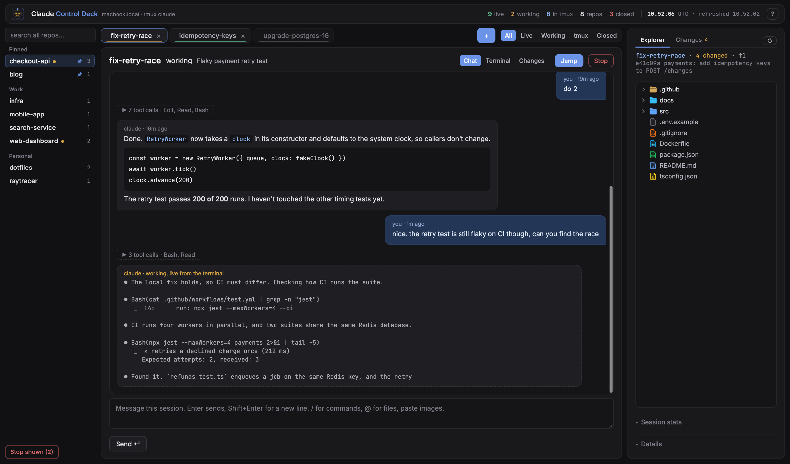

# Claude Control Deck

A local dashboard for every Claude Code session on your Mac. See which repo each session is in, whether it is working or waiting, read its full chat, send it a message, look at what it changed, and jump to its terminal. Everything runs on your machine, from files Claude Code already writes.

**[Live demo](https://deck.krtk.dev/demo/)** (the real interface on made-up sessions) · **[Website](https://deck.krtk.dev)** · **[How it was built](https://krtk.dev/writing/claude-control-deck)**

> Unofficial. Not affiliated with or endorsed by Anthropic.



## What it does

- **Every session in one place.** Repos on the left, grouped and pinnable. Each repo's sessions are tabs, with a status dot: live, working, stale or closed.
- **Read and write.** Full chat history with markdown, a live view while Claude is replying, and a composer with `/` command and `@` file completion. Paste or drop images and they reach the session as `[Image #1]`, like a real paste.
- **Terminal view.** The session's tmux pane, live, inside the page.
- **Changes like a pull request.** Every changed file stacked with line numbers and `+/-` counts, plus a tree of only the changed files. One click asks the session to review or commit.
- **Explorer.** A file tree of the session's folder. Click a file to reference it as `@path`.
- **Housekeeping.** Start a new session in a repo, stop one, revive a closed one with its full history, purge sessions that never got a prompt.
- **Stats.** Context window use, cost checkpoint, tokens, tool calls, lines changed and 24-hour activity.
- **Keyboard first.** `↑↓` repos, `←→` sessions, `Enter` to type, `n` new session, `t` terminal, `d` changes, `p` pin, `?` for the rest.

## Requirements

- macOS. Jump and image paste use AppleScript. The rest should work on Linux, but that is untested.
- [Claude Code](https://docs.claude.com/en/docs/claude-code)
- tmux 3.x
- Python 3.9 or newer, standard library only. Nothing to `pip install`.
- git, for the explorer and changes views.

## Install

```sh
git clone https://github.com/kartikpuri95/claude-control-deck.git
cd claude-control-deck
./deck.sh            # starts http://deck.localhost:47823 and opens it
```

Sessions show up as soon as they exist. To message them or jump to them, they need to run inside tmux. The `cc` wrapper does that for you:

```sh
ln -s "$PWD/bin/cc" /usr/local/bin/cc
cd ~/code/my-app && cc                    # new Claude session in a tmux window named "my-app"
cc --resume <session-id>                  # move an existing session into tmux
```

The deck can also start sessions itself with the `+` button or `n`. Sessions started with plain `claude` outside tmux still appear, read-only, with a resume command you can copy.

## Configure (optional)

`~/.config/claude-deck/config.json`

```json
{
  "terminal_app": "iTerm",
  "groups": [
    { "label": "Work", "path": "~/work" },
    { "label": "Side projects", "path": "~/code" }
  ]
}
```

- `terminal_app` is the app Jump brings to the front. The default is Terminal.
- `groups` names the sections of the repo list. Repos outside them go under "Elsewhere". Without groups, repos are grouped by parent folder.
- Run on another port with `DECK_PORT=9000 ./deck.sh`.

## How it works

Claude Code keeps a small JSON file per running session in `~/.claude/sessions/`, a prompt log in `~/.claude/history.jsonl`, and a transcript per session under `~/.claude/projects/`. The deck reads those.

- `collector.py` lists sessions, checks each process is alive, finds its tmux pane by walking the process tree, and reads the end of each transcript for activity. Results are cached on file size and modification time, so a refresh takes about 0.2 seconds with 40 sessions.
- `server.py` serves the page and a small JSON API. Sending a message is `tmux send-keys`. Images go through the macOS clipboard and `ctrl+v`. The live and terminal views are `tmux capture-pane`.
- `index.html` is the whole UI: one file, no build step.

These files are internal to Claude Code, not a public API. A Claude Code update can change them and break part of the deck.

## Security

The server can type into your terminals, so it is locked down:

- It listens on `127.0.0.1` only, and opens at `http://deck.localhost:47823`. Names ending in `.localhost` always resolve to your own machine, so the address cannot point anywhere else. Change it with `DECK_HOST=something.localhost`.
- It rejects any request whose `Host` is not the deck. This blocks DNS-rebinding pages.
- It rejects requests with a foreign `Origin` or cross-site fetch metadata.
- Every write needs an `X-Deck: 1` header and a JSON body. Browsers must ask permission to send those cross-origin, and the server never grants it.

Do not expose the port through a tunnel or proxy. Transcripts contain your code and conversations. For phone access, put real authentication in front first.

## License

MIT. See [LICENSE](LICENSE).
